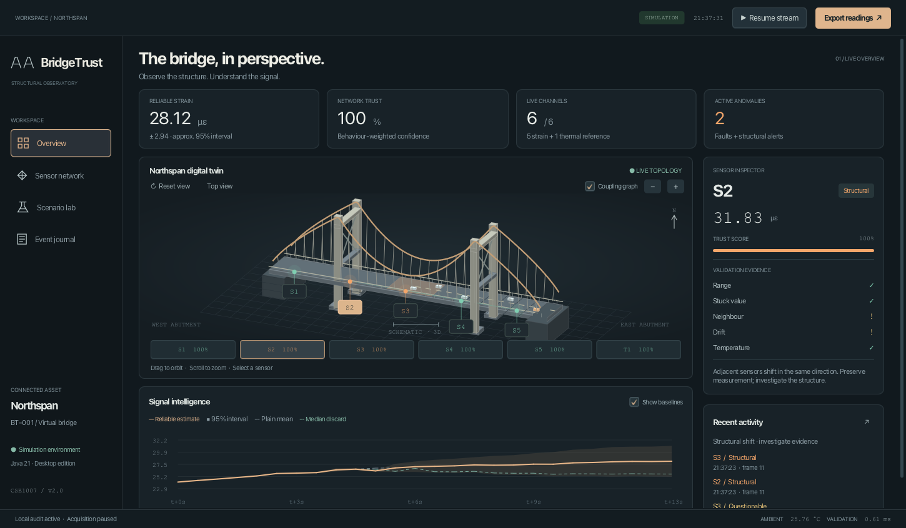

# BridgeTrust Observatory

**Is that sensor broken, or is the bridge changing?**

A native Java desktop application for multi-sensor validation, explainable fault classification and reliable strain estimation. Java 21 runs the engine, JavaFX renders the entire interface, and JDBC mirrors the audit into MySQL. No browser, JavaScript, web server, Spring or frontend framework is used.

## Start

Install **JDK 21 or newer** and **Maven 3.9+**. Maven resolves JavaFX and the MySQL driver for your operating system.

```sh
./run.sh
```

Windows: run `run.bat`. Alternatively, on any OS:

```sh
mvn compile javafx:run
```

The supplied development workspace can also use its ignored local toolchain through [scripts/maven.sh](scripts/maven.sh). That toolchain is not part of the source distribution. The first dependency resolution needs internet access.

## The workspace

- **Overview:** an orbitable procedural 3D suspension bridge, clickable sensor markers, physical coupling overlay, measured trust bars, confidence-band chart and a linked evidence inspector. Drag to orbit; scroll to zoom; use Reset or Top view. Geometry is projected and depth-sorted in JavaFX Canvas, so it does not require hardware JavaFX 3D support.
- **Sensor network:** raw and compensated measurements, current verdicts, trust, reconstructed values and a physical adjacency diagram. Double-click a channel to inspect it.
- **Scenario lab:** normal traffic, spike, stuck signal, slow drift, real dropout, coherent structural shift, thermal swing and malformed data. Includes CSV replay, three-method comparison and reproducible evaluation.
- **Event journal:** timestamped state transitions, evidence, verdict filters and review acknowledgement. Acknowledgement marks review in the current UI session; it does not clear a fault or erase the durable event.

Keyboard: **1–4** switch workspaces, **Space** pauses/resumes acquisition, **R** resets the model view. Native controls also support keyboard focus and activation.

The virtual asset is called Northspan. Its geometry is a schematic, not a surveyed digital twin. The application explicitly labels simulated and replayed data.



## What the engine does

1. Six dedicated sensor feed threads publish immutable readings into a bounded queue. A frame coordinator rejects duplicate/late readings and flushes incomplete frames after 750 ms. Missing channels do not stall subsequent frames.
2. Two validation workers execute independent pipelines over sensor histories: range, stuck value, neighbour deviation, two-sided CUSUM drift and verified temperature compensation.
3. A physical line graph (`S1 — S2 — S3 — S4 — S5`) distinguishes isolated deviation from adjacent coherent movement. Soft anomalies require two consistent frames. Hard failures are immediate.
4. Faults reduce trust; healthy behaviour restores it gradually. Confirmed structural readings remain in fusion. Suspect readings are withheld during confirmation.
5. Trust-weighted fusion reports a value, effective sensor count and an **approximate** 95% interval. One contributor has no interval; no contributors means unavailable. An invalid thermal reference withholds the compensated estimate.
6. Failed strain sensors are reconstructed from eligible direct neighbours. Virtual values are displayed and audited separately; they never inflate the independent contributor count.
7. Immutable snapshots feed the UI and a bounded asynchronous audit writer. Local audit is written first. MySQL transactions mirror each frame when configured. A local audit failure stops further processing; a database failure leaves local auditing active and reports degraded status.

## CSV replay and export

Use **Scenario lab → Import CSV replay**. The exact input format is:

```csv
tick,sensor,value
0,S1,25.1
0,S2,25.2
0,S3,25.0
0,S4,25.3
0,S5,25.1
0,T1,22.0
```

Rows must have nondecreasing, nonnegative integer ticks and unique channel/tick pairs. Valid channels are S1–S5 and T1. An omitted channel or blank value represents a dropout; `NaN` represents a transmitted malformed value. Limits: 10 MB and 20,000 frames. Playback normalizes frame spacing to 2 Hz and stops at EOF. Every frame needs at least one transmitted reading. An [example replay](data/example-replay.csv) is included.

**Export readings** exports the in-memory window (up to 360 frames / approximately 3 minutes) in replay format. **Export event journal** exports up to 200 recent transitions and session review markers. Full session records remain on disk. Evaluation results have a separate export.

## Persistence and MySQL

Local mode works without a database. The command-line launcher writes into `data/`; set `BT_DATA_DIR` to choose another location. Installed desktop bundles default to `~/.bridgetrust`.

Each UUID-named session contains `readings.csv`, `estimates.csv` and `events.csv`. The trust checkpoint is atomically replaced in `trust-v2.ser` and restored through an object deserialization allowlist. Legacy prototype files are not overwritten or loaded.

Create an empty MySQL 8+ database and a dedicated application user with table creation and read/write privileges in that database. Configure credentials outside source control:

```sh
export BT_DB_URL='jdbc:mysql://localhost:3306/bridgetrust'
export BT_DB_USER='bridgetrust'
export BT_DB_PASS='your-local-password'
./run.sh
```

For remote servers, configure verified TLS in the JDBC URL. Connector/J is a Maven runtime dependency. JDBC creates the versioned `bt_readings`, `bt_estimates`, `bt_events` and `bt_trust` tables. Prepared statements, batching, transaction rollback, connection/read timeouts and SQL NULL for unavailable numbers are implemented. The UI reports connection failures. Automatic reconnect/backfill is not implemented; the local session remains the recovery record. Schema changes require an explicit migration before deploying a future incompatible version.

## Verify and evaluate

```sh
mvn verify
mvn javafx:run -Djavafx.args=--benchmark
# Or use the local-toolchain helper:
sh scripts/verify.sh
# Opens a real JavaFX window, operates scenario controls, captures a PNG, then exits:
sh scripts/verify.sh --ui
```

Tests cover fault versus structural discrimination, physical adjacency, missing/malformed channels, thermal failure, stuck detection and trust recovery, fusion edge cases, replay rejection, checkpoint round trips, bounded frame assembly and fixed-seed comparative evaluation. The opt-in native UI harness writes its result and screenshot under `target/`.

Evaluation runs eight scenarios, 200 frames each, scoring frames 65–199 after warm-up and injection onset. Detection/classification rates use labelled sensor samples. Estimation error compares all methods against the spatial mean of genuine strain, including structural shifts. Validation never receives scenario labels or simulation truth. See [verification notes](docs/VERIFICATION.md) for observed results and test limitations.

## Build a native desktop bundle

```sh
sh scripts/package.sh
```

This runs verification, gathers runtime dependencies and creates a `jpackage` application image with a bundled Java runtime under `target/distribution`. Build on each target OS/architecture. Installers, application signing and notarization are separate release steps. Windows can use the same Maven goals and JDK `jpackage` options in [the packaging script](scripts/package.sh).

For another build when the output image already exists, choose a fresh destination with `BT_PACKAGE_DEST=target/distribution-next sh scripts/package.sh`. JavaFX is packaged on the module path. Original application icons can be regenerated with `java scripts/CreateIcon.java`.

## Java syllabus mapping

| Topic | Implementation |
|---|---|
| OOP, inheritance, abstraction | Abstract [Sensor](src/main/java/bridgetrust/model/Sensor.java), concrete strain/temperature feeds, immutable records, enums |
| Interfaces and polymorphism | [ValidationStage](src/main/java/bridgetrust/stages/ValidationStage.java), five stage implementations and [Storage](src/main/java/bridgetrust/store/Storage.java) |
| Custom exceptions | [MalformedReadingException](src/main/java/bridgetrust/engine/MalformedReadingException.java), typed replay failures and UI error handling |
| Threads, synchronization, communication | Six feed executors, two validation workers, blocking queue, frame coordinator, atomic snapshots, asynchronous audit worker |
| Collections, generics, lambdas | Maps of trust/history, graph adjacency, bounded deques, statistical streams, generic table columns |
| File I/O and serialization | CSV replay/audit/export; filtered, atomic trust checkpoints |
| JDBC / MySQL | [JdbcStorage](src/main/java/bridgetrust/store/JdbcStorage.java), batched prepared statements and per-frame transactions |
| JavaFX | Native controls, Canvas geometry/charts, timelines, keyboard navigation and CSS styling |

## Scope and engineering limits

This is a hardened **simulation and recorded-data desktop project**, not a certified bridge safety system. Processing is distributed across threads inside one JVM, not across networked machines. Thresholds and the thermal coefficient are fixed and require calibration for a real asset. A majority/common-mode change can move the reference median and cannot reliably be distinguished from load using these six channels alone. Correlated faults can resemble structural changes. A structural verdict is evidence for investigation, not proof of damage. Confidence intervals assume approximately independent residuals and are not calibrated safety bounds.

Before field deployment: validate against labelled real data, configure physical coupling and sensor calibration, assess uncertainty under correlation, implement authenticated device ingestion, retention/backup policy, database migrations and operational recovery, and complete independent structural-engineering validation. See [architecture](docs/ARCHITECTURE.md).

Visual research: [Dribbble infrastructure dashboards](https://dribbble.com/search/infrastructure-dashboard). The geometry, layout, icons and charts in this project are original, rendered directly in JavaFX.
